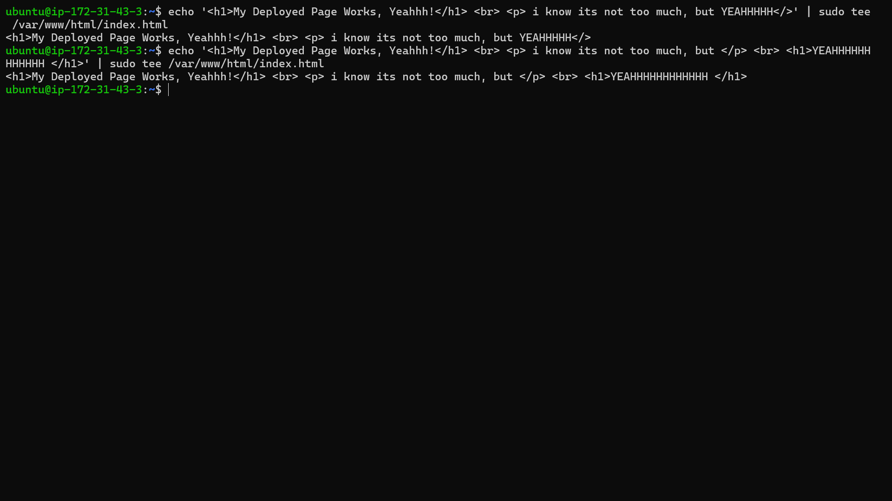
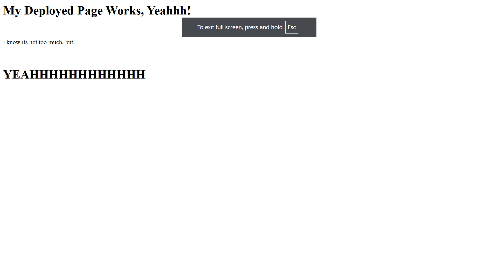

# 🌐 Deploying a Static Website on AWS EC2 Using NGINX

## 📌 Project Overview

This project demonstrates how to deploy and host a static website on an **Amazon EC2 instance** using **NGINX** as the web server.

The objective was to understand how cloud infrastructure can be configured to host a publicly accessible website using a virtual Linux server.

Instead of using fully managed website hosting services, I manually provisioned an EC2 instance, established an SSH connection through Windows PowerShell, installed and configured NGINX, deployed a custom HTML webpage, and configured AWS Security Groups to allow HTTP traffic.

This hands-on project provided practical experience with cloud infrastructure, Linux server administration, web server deployment, and cloud networking fundamentals.

## 🎯 Project Objectives

- Provision a virtual server using Amazon EC2.
- Establish a remote SSH connection using a `.pem` key pair.
- Install and configure NGINX on a Linux server.
- Deploy a custom static HTML webpage.
- Configure AWS Security Groups to control inbound traffic.
- Make the hosted website publicly accessible through the EC2 public IPv4 address.
- Understand the fundamentals of client-server communication and HTTP.

## 🛠️ Technologies & AWS Services Used

| Technology / Service | Purpose |
|---|---|
| Amazon EC2 | Provides the cloud-based virtual server. |
| Linux | Operating system for the EC2 instance. |
| NGINX | Web server used to serve static content. |
| SSH | Secure remote access to the Linux server. |
| Windows PowerShell | SSH client used to connect to EC2. |
| AWS Security Groups | Controls inbound and outbound network traffic. |
| HTML | Used to create the static webpage. |

## 🏗️ Architecture

The project follows a basic client-server architecture in which an EC2 instance hosts the website through the NGINX web server.

### Deployment and Access Architecture

```text
                  LOCAL MACHINE
                (Windows PowerShell)
                        |
                        |
                  SSH - Port 22
                   (.pem Key)
                        |
                        ▼
                 AWS EC2 INSTANCE
                   (Linux Server)
                        |
                        ▼
                  NGINX WEB SERVER
                        |
                        ▼
                 DOCUMENT ROOT
                        |
                        ▼
                   index.html


              WEBSITE ACCESS FLOW

                 CLIENT BROWSER
                        |
                        |
                  HTTP - Port 80
                        |
                        ▼
                AWS SECURITY GROUP
                        |
                        ▼
                 AWS EC2 INSTANCE
                        |
                        ▼
                  NGINX WEB SERVER
                        |
                        ▼
                 STATIC WEBPAGE
```

## ⚙️ Implementation Process

### Step 1: Launching an Amazon EC2 Instance

First, I provisioned a virtual server using Amazon EC2.

The following steps were performed:

1. Opened the AWS Management Console.
2. Navigated to the Amazon EC2 service.
3. Launched a new EC2 instance.
4. Selected a Linux-based Amazon Machine Image (AMI).
5. Selected an appropriate EC2 instance type.
6. Created and downloaded an SSH key pair in `.pem` format.
7. Launched the instance and verified that its state was `Running`.

The EC2 instance provided the computing environment required to host the website.

### Step 2: Connecting to EC2 Using SSH

After launching the instance, I established a remote SSH connection using Windows PowerShell.

**SSH command:**

```powershell
ssh -i "your-key.pem" ec2-user@YOUR_PUBLIC_IP
```

For Ubuntu instances, the default SSH username is generally `ubuntu`, whereas Amazon Linux instances generally use `ec2-user`.

**Ubuntu example:**

```powershell
ssh -i "your-key.pem" ubuntu@YOUR_PUBLIC_IP
```

The `.pem` file contains the private key required for authentication.

This established a secure connection between my local Windows machine and the remote Linux server.

### Step 3: Installing and Configuring NGINX

After successfully connecting to the EC2 instance, I installed the NGINX web server.

**For Ubuntu:**

```bash
sudo apt update
sudo apt install nginx -y
```

**For Amazon Linux 2023:**

```bash
sudo dnf update -y
sudo dnf install nginx -y
```

After installation, I started the NGINX service:

```bash
sudo systemctl start nginx
```

Enabled NGINX to start automatically whenever the server reboots:

```bash
sudo systemctl enable nginx
```

Verified the service status:

```bash
sudo systemctl status nginx
```

Once NGINX was running, the server was ready to handle HTTP requests.

### Step 4: Deploying the Static Website

NGINX serves website files from a configured directory known as the **document root**.

The default document root depends on the Linux distribution:

| Operating System | Default Document Root |
|---|---|
| Ubuntu | `/var/www/html/` |
| Amazon Linux 2023 | `/usr/share/nginx/html/` |

For my deployment, I created or edited the default HTML file in the appropriate document root.

**Ubuntu:**

```bash
sudo nano /var/www/html/index.html
```

**Amazon Linux 2023:**

```bash
sudo nano /usr/share/nginx/html/index.html
```

I added custom HTML content and saved the file.

NGINX then served the webpage whenever a client requested the website.

### Step 5: Configuring AWS Security Groups

To make the website publicly accessible, I configured the EC2 instance's Security Group.

Security Groups act as virtual firewalls that control network traffic to and from EC2 instances.

**Inbound Security Group Rules:**

| Type | Protocol | Port | Source | Purpose |
|---|---|---|---|---|
| SSH | TCP | 22 | My IP | Secure remote server access |
| HTTP | TCP | 80 | `0.0.0.0/0` | Public website access |

**Why are these ports required?**

- **Port 22 (SSH):** Allows secure remote administration of the EC2 instance.
- **Port 80 (HTTP):** Allows users to access the hosted website through a web browser.

SSH access was restricted to my IP address, while HTTP access was permitted from anywhere on the internet.

### Step 6: Accessing the Deployed Website

After configuring NGINX and the Security Group, I verified the website deployment.

The following steps were performed:

1. Copied the EC2 instance's Public IPv4 address.
2. Opened a web browser.
3. Entered the public IP address using the HTTP protocol.

**Website URL:**

```text
http://YOUR_EC2_PUBLIC_IP
```

The browser successfully accessed and displayed the static webpage hosted on the EC2 instance.

This confirmed that NGINX was serving the website and that the AWS network configuration allowed external HTTP traffic.

## 📸 Project Screenshots

The following screenshots demonstrate the deployment and configuration process.

### 1. NGINX Installation and Configuration

Shows the installation and configuration of the NGINX web server on the EC2 Linux instance.



### 2. Successful Website Deployment

Shows the static webpage successfully hosted on the EC2 instance and accessed through its public IPv4 address.



## 📚 Key Learnings

Through this hands-on project, I gained practical experience in the following areas:

### 1. Amazon EC2

- Launching and managing virtual machines in AWS.
- Understanding EC2 instance states and public IPv4 addresses.
- Hosting applications on cloud-based virtual servers.
- Understanding how cloud infrastructure connects to external clients.

### 2. SSH and Remote Server Administration

- Establishing SSH connections through Windows PowerShell.
- Understanding `.pem` key pairs and SSH authentication.
- Remotely managing Linux servers.
- Understanding secure remote access.

### 3. Linux Server Administration

- Installing software packages using package managers.
- Managing services using `systemctl`.
- Working with Linux directories, files, and permissions.
- Understanding web server document roots.

### 4. NGINX Web Server

- Understanding the role of a web server.
- Installing and managing NGINX.
- Serving static HTML content.
- Understanding HTTP request and response handling.

### 5. AWS Security Groups

- Understanding Security Groups as virtual firewalls.
- Configuring inbound traffic rules.
- Understanding TCP ports 22 and 80.
- Controlling network access to cloud resources.

### 6. Cloud Networking Fundamentals

- Understanding client-server communication.
- Learning how public IP addresses enable internet accessibility.
- Understanding the relationship between network ports, firewall rules, and web servers.
- Understanding how external clients communicate with applications hosted on cloud infrastructure.

## 🔍 Useful Linux Commands

| Command | Purpose |
|---|---|
| `sudo apt update` | Updates Ubuntu package information. |
| `sudo apt install nginx -y` | Installs NGINX on Ubuntu. |
| `sudo dnf install nginx -y` | Installs NGINX on Amazon Linux 2023. |
| `sudo systemctl start nginx` | Starts the NGINX service. |
| `sudo systemctl enable nginx` | Enables automatic startup. |
| `sudo systemctl status nginx` | Checks the NGINX service status. |
| `sudo systemctl restart nginx` | Restarts the NGINX service. |
| `sudo ss -tlnp` | Displays listening TCP and UDP sockets. |
| `curl -I http://localhost` | Checks the local HTTP response. |

## 🚀 Future Improvements

I plan to extend this project by implementing additional AWS services and DevOps tools.

- **Terraform:** Automate EC2 provisioning and Security Group configuration using Infrastructure as Code (IaC).
- **Amazon Route 53:** Configure a custom domain name for the website.
- **SSL/TLS:** Enable HTTPS communication to secure website traffic.
- **CI/CD:** Automate website deployment using a CI/CD pipeline.
- **Amazon CloudWatch:** Monitor EC2 performance, metrics, and logs.
- **Amazon VPC:** Explore subnets, route tables, Internet Gateways, and Network ACLs.
- **Load Balancing:** Explore Application Load Balancers to distribute incoming HTTP traffic.

## Project Author

**Vineet Vikram Rao**

---

⭐ This project represents one of my hands-on steps toward building practical knowledge of AWS cloud infrastructure, Linux administration, and cloud networking.

**Project Status:** Successfully Completed

**Primary Technologies:** Amazon EC2 | NGINX | Linux | SSH | AWS Security Groups | HTML
